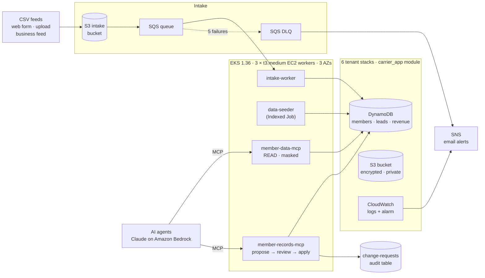
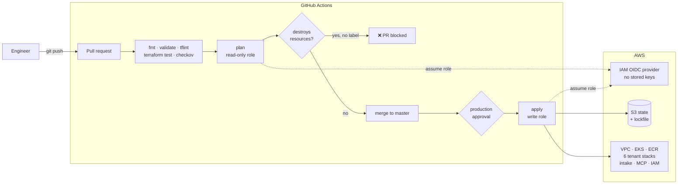
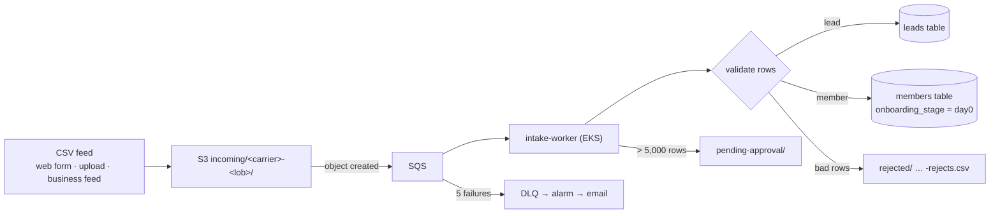

# Healthcare Insurance Infrastructure Platform

A multi-tenant healthcare insurance platform on AWS, built entirely with **Terraform** and run on **Amazon EKS**. One reusable module provisions isolated tenant stacks for three carriers (**Blue Cross**, **Hartford**, **Allstate**) across **Personal** and **Business** lines of business. Every change ships through a **GitHub Actions CI/CD pipeline** with tests, policy-as-code, and a human approval gate.

> **Demo project.** Carrier names are used only as tenant labels for a portfolio exercise. All member data is **synthetic**: emails use the reserved `example.com` domain and phone numbers use the fictional `555-01xx` range.

---

## 🗺️ Architecture



Runtime view: data flows left to right. The CI/CD view (how changes reach AWS) is in the next section.

**How to read it**

- **Shared (pooled):** one VPC, one EKS cluster, one intake pipeline, one pipeline in GitHub.
- **Isolated (siloed) per tenant:** each of the 6 provisions gets its own bucket, tables, IAM role, and alarms.
- **No long-lived keys anywhere:** GitHub uses OIDC, the workstation uses an instance profile, and pods use **EKS Pod Identity**, each with a least-privilege role.

---

## 📊 Current State

| Layer | What is running | Managed by |
|---|---|---|
| Terraform state | S3 bucket `healthcare-insurance-tfstate-<account>`, versioned, with lockfile | `providers.tf` |
| Tenant stacks (× 6) | S3 bucket, IAM role, CloudWatch logs + alarm, DynamoDB **members**, **leads**, **revenue** tables | `terraform_modules/carrier_app` |
| Shared monitoring | SNS email topic, CPU + status-check alarms, dashboard | `cloudwatch.tf` |
| Network | VPC across 3 AZs, private subnets for nodes, single NAT gateway | `network.tf` |
| Kubernetes | EKS 1.36, managed node group of **3 × t3.medium EC2 workers** | `eks.tf` |
| Image registry | ECR repos (immutable tags, scan on push, keep last 10) | `ecr.tf` |
| Member data | **500,004 synthetic members** + monthly revenue Jan 2021 → today | `seeder.tf`, `tools/data_seeder`, `k8s/data-seeder.yaml` |
| Intake pipeline | S3 landing bucket → SQS (+ DLQ + alarm) → intake worker on EKS | `intake.tf`, `workers/intake`, `k8s/intake-worker.yaml` |
| MCP tool servers | `member-data-mcp` (read) and `member-records-mcp` (write via approval) | `mcp.tf`, `mcp_servers/`, `k8s/mcp-tools.yaml` |
| Change audit | `healthcare-change-requests` table: every proposed change, decision, before/after | `mcp.tf` |
| AI access | Amazon Bedrock (Claude), FRED API key in Secrets Manager | `agents.tf` |
| CI/CD | GitHub Actions + OIDC: read-only plan role, environment-gated apply role | `github_oidc.tf`, `.github/workflows/terraform.yml` |

---

## 🚦 CI/CD Pipeline



| Stage | Tool | What it catches |
|---|---|---|
| Format + syntax | `terraform fmt -check`, `terraform validate` | Unformatted code, invalid references |
| Lint | `tflint` (recommended preset) | Missing version pins, unused code, untyped variables |
| Unit tests | `terraform test` with mock providers | Module behavior: naming, deletion protection, PITR, encryption, private buckets, input validation |
| Policy-as-code | `checkov` | Insecure settings. Accepted risks are listed with reasons in `.checkov.yaml` or inline. |
| Plan | `terraform plan` (read-only role) | What will change. Posted on the PR. **Blocks PRs that destroy resources** unless labelled `allow-destroy`. |
| Apply | `terraform apply` (write role) | Runs only after approval in the `production` environment |

**Module tests** (`terraform_modules/carrier_app/tests/carrier_app.tftest.hcl`):

| Test | Asserts |
|---|---|
| `resources_follow_naming_convention` | Tables and role named `<carrier>-<lob>-…` |
| `tenant_data_is_protected` | Deletion protection, PITR, encryption on every table |
| `tenant_bucket_is_private_and_encrypted` | All public access blocked, SSE enabled |
| `sparse_indexes_exist_for_onboarding_and_winback` | `onboarding-index` and `lapsed-index` exist |
| `rejects_unknown_line_of_business` | Input validation rejects `commercial` |
| `rejects_badly_formatted_carrier_name` | Input validation rejects `Blue Cross` |

Run locally:

```bash
cd terraform_modules/carrier_app && terraform init -backend=false && terraform test
docker run --rm -v "$PWD":/data -t ghcr.io/terraform-linters/tflint:v0.59.1 --recursive --config /data/.tflint.hcl
docker run --rm -v "$PWD":/tf bridgecrew/checkov -d /tf --config-file /tf/.checkov.yaml
```

---

## 🧩 The Six Tenant Provisions

`main.tf` calls the `carrier_app` module once per carrier and line of business:

| | Personal | Business |
|---|---|---|
| **Blue Cross** | `blue_cross_personal` | `blue_cross_business` |
| **Hartford** | `hartford_personal` | `hartford_business` |
| **Allstate** | `all_state_personal` | `all_state_business` |

| Resource per provision | Name pattern |
|---|---|
| S3 bucket (AES256, public access blocked) | `health-app-<carrier>-<lob>-<random>` |
| IAM execution role | `app-execution-role-<carrier>-<lob>` |
| CloudWatch log group, error filter, alarm | `/aws/ecs/<carrier>-<lob>` |
| DynamoDB members / leads / revenue | `<carrier>-<lob>-members`, `-leads`, `-revenue` |

Inputs are validated: `carrier_name` must be lowercase and hyphenated, and `line_of_business` must be `personal` or `business`.

---

## 🗄️ Data Model (DynamoDB)

**`<carrier>-<lob>-members`**: partition key `member_id` (e.g. `BLP-0000001`)

| Attribute | Notes |
|---|---|
| `first_name`, `last_name`, `email`, `phone` | Synthetic contact details |
| `status` | `active`, `inactive`, or `deleted` (soft delete) |
| `enrolled_date` | ISO date |
| `onboarding_stage` | `day0` / `day7` / `day30`, present **only** while in onboarding |
| `lapse_year`, `lapsed_date` | Present **only** on inactive members |
| `monthly_premium`, `consent_email`, `consent_sms` | Billing and contact consent |

Sparse global secondary indexes: **`onboarding-index`** (new members) and **`lapsed-index`** (win-back candidates, partitioned by lapse year).

**`<carrier>-<lob>-leads`**: `lead_id`, `lead_status` (`new` / `contacted` / `converted` / `closed`), `received_date`, with a `status-index`.

**`<carrier>-<lob>-revenue`**: `year` + `month` → `premium_revenue`, `claims_paid`, `members_billed`.

All tables: on-demand billing, encryption, point-in-time recovery, **deletion protection on**.

---

## 📥 Intake Pipeline



- IDs are derived from provision + email, so re-sending a feed never creates duplicates.
- The worker can **add** members and leads but cannot delete them or touch revenue.

---

## 🤖 MCP Tool Servers (AI agent layer)

MCP servers give AI agents (Claude on Amazon Bedrock) **governed** access to the platform. They run on EKS as internal-only services.

| Server | Tools | AWS permissions |
|---|---|---|
| `member-data-mcp` | `list_provisions`, `get_member`, `count_/list_onboarding_members`, `count_/list_lapsed_members`, `list_leads`, `revenue_summary` | `GetItem`, `Query` only. **Contact details are always masked.** |
| `member-records-mcp` | `propose_change`, `review_change`, `apply_change`, `get_change_request`, `list_change_requests` | Write members and leads **only through approved change requests** |

**Approval flow:** `propose` (pending, before-snapshot) → `review` (approve/reject; **hard deletes need `human_confirmed`**) → `apply` (**refuses anything not approved**; stores the after-snapshot). The `healthcare-change-requests` table is the audit trail.

---

## 🛠️ Operations

### First-time setup

```bash
cp terraform.tfvars.example terraform.tfvars   # monitored_instance_id, alert_email, admin_cidr
terraform init
aws eks update-kubeconfig --region us-east-1 --name healthcare-eks
kubectl get nodes -L topology.kubernetes.io/zone
```

### Making a change

```bash
git checkout master && git pull
git checkout -b feature/<name>
# edit, then check locally
terraform fmt -recursive && terraform validate && terraform plan
git add <files> && git commit -m "What changed and why"
git push -u origin feature/<name>
# open a PR → CI runs checks + plan → review → merge → approve "production" → CI applies
```

### Cost control

EKS, its 3 workers, and the NAT gateway cost about **$5–6 per day**. Tear down the platform only (keeps tables, data, buckets, images, state):

```bash
terraform plan -destroy -target=module.eks -target=module.vpc -out=teardown.tfplan
terraform apply teardown.tfplan
```

Rebuild with `terraform apply`, then re-deploy workloads:

```bash
kubectl apply -f k8s/intake-worker.yaml -f k8s/mcp-tools.yaml
```

---

## 🏗️ Repository Layout

```text
├── .github/workflows/terraform.yml  # CI/CD pipeline
├── .checkov.yaml                    # policy-as-code settings + documented exceptions
├── .tflint.hcl                      # lint rules
├── 1_providers_and_facilities/      # medical configurations & triage protocols
├── 2_insurance_operations/          # claims processing records
├── 3_crm_and_patients/              # EHR & patient histories
├── 4_underwriting_finance/          # commissions & disbursements
├── k8s/                             # data-seeder, intake-worker, mcp-tools manifests
├── mcp_servers/                     # member_data (read), member_records (write)
├── terraform_modules/carrier_app/   # reusable tenant module + tests/
├── tools/data_seeder/               # synthetic data loader
├── workers/intake/                  # intake worker
├── main.tf                          # 6 tenant module calls
├── providers.tf · variables.tf      # providers, S3 backend, inputs
├── network.tf · eks.tf · ecr.tf     # platform
├── intake.tf · seeder.tf · mcp.tf   # workloads' AWS resources and IAM
├── agents.tf · github_oidc.tf       # Bedrock/secrets, CI identities
├── cloudwatch.tf                    # shared monitoring
└── gen_imports.sh                   # state-recovery helper
```

---

## 📜 Change History

| PR | Change |
|---|---|
| #1 | **State recovery.** State had lived on a terminated EC2 and a second apply created duplicate buckets. Moved state to S3 with locking, imported 58 live resources, removed 6 orphaned buckets. |
| #2 | **EKS platform.** VPC across 3 AZs, EKS 1.36 with Pod Identity, 3-node EC2 worker group, ECR. |
| #3 | **Member data.** Per-tenant DynamoDB tables; containerized seeder (Indexed Job) loaded 500,004 synthetic members. |
| #4 | **Bedrock access.** Claude via Bedrock; FRED API key container in Secrets Manager (value set outside Terraform). |
| #5 | **Intake pipeline.** S3 → SQS + DLQ → intake worker; leads tables. |
| #6 | **MCP servers + CI/CD.** Read and write MCP servers with change-request approval flow; module tests, tflint, checkov, OIDC roles, GitHub Actions pipeline. |
| #7 | **Pipeline fix.** Corrected the checkov action; accepted `CKV_AWS_274` on the CI apply role with an inline, documented exception. |

---

## ⚠️ Known Issues and Follow-ups

- **CI apply role uses `AdministratorAccess`** (inline checkov exception). Replace with a scoped policy.
- Tenant IAM execution roles have no permission policies yet and trust EC2 only. Replace with per-tenant Pod Identity roles (`carrier-namespaces`).
- Shared services (intake worker, MCP servers) can reach all 6 tenants' tables; per-tenant namespaces and roles would make AWS enforce the isolation.
- Tenant error alarms have `actions_enabled = false`.
- Tenant buckets: no versioning or lifecycle rules (`force_destroy = true`).
- AWS provider deprecation: `hash_key`/`range_key` → `key_schema` on DynamoDB tables. Fix in a PR whose plan shows **No changes**.
- `k8s-deployment.yaml` (original) targets the `default` namespace with a local-only image; superseded by the manifests in `k8s/`.

---

## 🗺️ Roadmap

| Next | Adds |
|---|---|
| Ansible | Playbook that rebuilds the workstation (Terraform, Docker, kubectl, Git) |
| AI infra agent | Chat request → generated Terraform → PR → CI checks → human merge |
| Agents | Owner, Supervisor, Records agents with a browser chat UI and approval pop-ups |
| Monitor / Team Lead / Advisor | Feed and queue monitoring; bundle-incentive campaigns (SES/SMS); FRED market insights |
